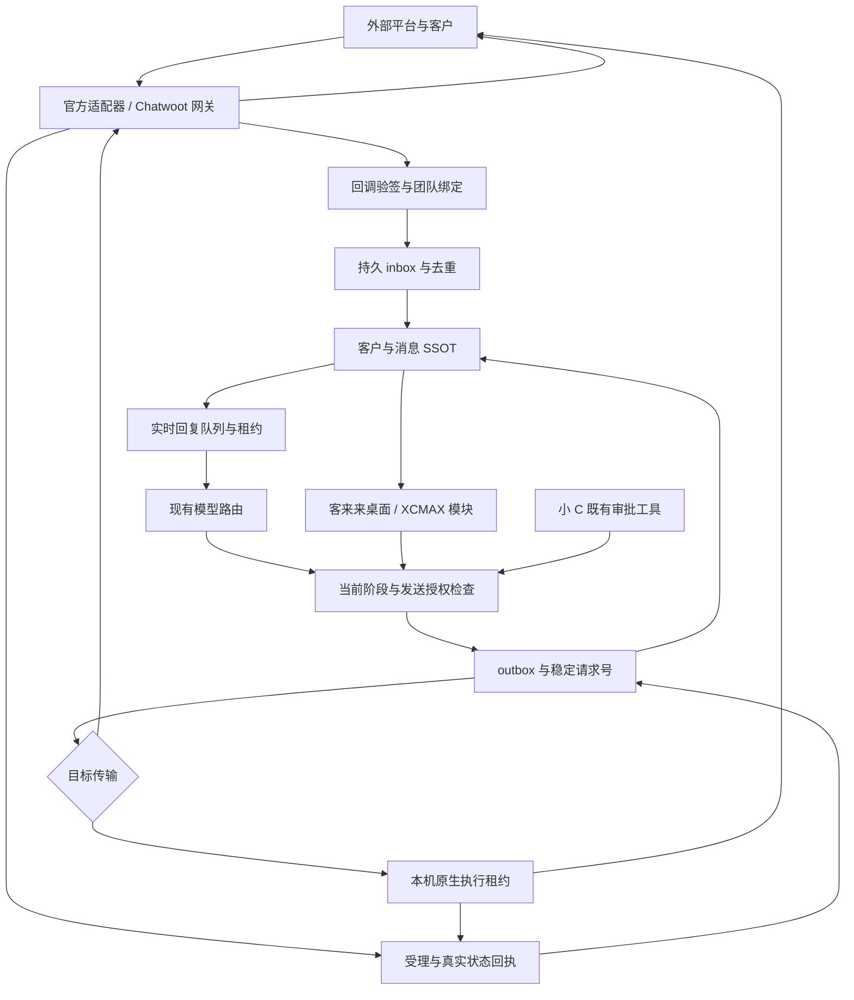

# 客来来

客来来负责外部渠道、账号连接、客户身份、消息收发和回复任务。XCMAX 通过可撤销的授权读取这些能力，并在“智能生态 / 客来来”模块中复用宿主模型、ELT、客户消息组件和已有 Agent 审批运行时。

## 当前交付边界

本轮审计基线为 Kellai `cbe783af897a746320f220a8fe4bbea7f66d5976`、XCMAX `48f8f40d14dfc373afd4ca43790c560f78b44481`。下面的“已实现”指代码与持久化协议已接通；候选分支、协议隔离测试、已保存配置都不代表上线或真实送达。渠道目录统一保留 `live_verified=false`，真实账号验收需另外取得平台消息 ID、回执和收件端证据。

核心路径已落实为：**签名回调 → 持久收件箱 → 客户与消息 → 人工或真实模型回复 → 授权与发送账本 → 渠道受理 → 回执查询及会话回写**。未实现的电商聊天协议、任意个人微信私聊、语音外呼、图形流程执行及其他占位业务，均不能计入这个闭环。

### 架构与节点职责



| 节点 | 实际用途 | 实现位置 |
|---|---|---|
| 渠道目录 | 声明每个渠道实际能收、能发、传输类型、模板限制；能力不由前端名称推断 | `backend/app/channels/capabilities.py`、`registry.py` |
| 渠道配置 | 每个团队保存凭据，掩码展示，明确清空撤销；缓存按团队与配置指纹隔离 | `channels/config_store.py` |
| 回调入口 | 验证签名、时间、账号及团队，拒绝错账号/错 inbox/外发 echo | `api/wechat_callbacks.py`、`api/channel_gateway.py` |
| 持久 inbox | 先落消息再处理；保存或入队失败不确认消费，可重放 | `services/channel_ingest.py`、`message_store.py` |
| 客户与会话 | 绑定稳定渠道身份，保留消息和时间线；跨渠道同名或同编号不自动合并 | `services/growth_loop.py`、`pipeline.py` |
| 回复队列 | 合并同会话最新消息，租约防并发；发送前重读阶段和新入/出站 | `services/auto_reply_runtime.py` |
| 模型 | 复用已配置模型与上下文；模板兜底不能获得自动外发资格 | `services/ai_copilot.py`、`llm_config.py` |
| 发送入口 | 校验用户、团队、真实客户、稳定目标和自动回复租约 | `services/messaging.py` |
| outbox | 以团队和请求号去重；保存受理结果并修复会话投影；未知结果不盲重发 | `services/outbound_delivery.py` |
| worker | 无需打开网页也能处理 API 渠道；按具体目标区分 API 与原生桌面 | `services/channel_worker.py` |
| 原生执行 | 只有本机授权 prepare 能获得一次执行令牌；完成后提交受限回执 | `desktop/src/api/messages.ts`、`deliveryState.ts` |
| XCMAX 授权桥 | 固定 loopback、只读默认、显式发送 scope、批准人撤销校验 | `services/xcmax_integration.py`、`api/xcmax_channels.py` |

## 本轮确认的缺口及处理

| 编号 | 原缺口与影响 | 当前处理和证据 |
|---|---|---|
| C01 | 数据来源、客来来渠道和前端菜单各自声明能力 | XCMAX 普通 `kellai` Mod 统一五个工作区；能力只读 Kellai registry；旧路由兼容。见 XCMAX `FHD/README.md` |
| C02 | 全局 adapter 缓存让后一租户复用前一租户 token | 按 tenant/channel/config 指纹隔离；配置切换淘汰缓存，关闭时释放客户端。`test_channel_gateway.py` |
| C03 | 保存配置、实际读取配置的优先级不同，清空后 env 又恢复旧密钥 | 保存值优先，显式空值撤销，别名同步；多租户 env 凭据必须有明确归属。`test_channel_gateway.py` |
| C04 | 密钥原样返回、掩码回写、磁盘失败仍报成功 | 公共配置脱敏、掩码保留原值、原子保存失败向上传递；配置管理限制 owner/admin。`test_messaging_api.py` |
| C05 | 本地签名、URL 或空响应被当成已连接/已发送 | 验证层级区分 configured/authenticated；四个电商通道明确 blocked；无有效成功凭据保持 unknown。`test_channel_gateway.py` |
| C06 | 多个海外渠道只有发送函数，接收注释没有实际入口 | 新增 Chatwoot 官方 API + 签名 webhook 薄适配器，复用上游已有平台接入。原生能力仍如实标 outbound_only |
| C07 | 微信、企微回调缺少完整团队与消息绑定 | 公众号明文签名回调、企微现有 AES/suite 授权链统一进持久 inbox。`test_wechat_callbacks.py` |
| C08 | 入队失败仍消费消息，重复重放又重置已读/旧预览 | 公共 ingest 与抖音网页捕获先持久化、失败不 ack；已存消息重放不重复业务更新。`test_message_boundary_review.py`、`test_douyin_web_portal.py` |
| C09 | 不同渠道相同 contact_id 合并成一个人，迟到历史推进当前客户阶段 | 仅精确渠道映射或同渠道旧身份可匹配；迟到历史不回退当前预览、待办和阶段。`test_message_boundary_review.py` |
| C10 | 20 条历史会话可能被分批自动回复，演示消息也可入队 | 历史、模拟、演示、未解析媒体拒绝自动外发；先取全队列每会话最新，再限制数量。`test_auto_reply_runtime.py` |
| C11 | 生成期间新消息/人工回复/阶段变化不能取消旧草稿 | 生成完成和 begin_delivery 都核验原消息、当前客户、阶段与后续消息；原消息时间 900 秒窗口，最多允许 60 秒平台时钟偏差 |
| C12 | 多 worker 与前端重复重试会多发；超时被当失败重发 | SQLite 租约和 outbox 唯一请求号；一个请求只放行一次渠道调用；unknown 只查询。`test_delivery_runtime.py` |
| C13 | 原生执行结果可伪造、重复领取或换号上报；恢复记录损坏后可能重新外发 | prepare/complete 绑定令牌及原请求；已知执行结果恢复仅上报回执，不再次操作设备；请求存储读取或解析失败时停止新外发。`desktop/tests/message_delivery_state.test.mjs` |
| C14 | 抖音 bridge 无幂等、递归远端、云端客户 ID 与桌面混用 | 透传同一个 request ID；云端独立账本和稳定联系人解析；内部执行禁止回环与 native。`test_messaging_api.py` |
| C15 | 云 worker 抢走 relay inbox；hybrid 渠道永远不由 API worker 处理 | relay 角色不消费抖音游标；普通 CRM 按真实目标在领租约前分流 API/native。`test_channel_worker.py` |
| C16 | 企微取 token 自锁，suite 入站可用但出站未复用授权 | 修复锁递归，复用 tenant suite token/agent，并保留内部成员的实际能力范围。`test_channel_gateway.py` |
| C17 | 保存任意模型 URL 可能携带全局 key，旧探测结果误显示连通 | 模型 key 与 provider/endpoint 绑定；自有 key 优先、变更清旧验证、探测错误脱敏。`test_llm_config_boundary.py` |
| C18 | 账号切换后的旧 401 会用新账号 token 重放配置写请求 | 所有普通/loopback 请求捕获账户；延迟成功、401、刷新前后均校验，刷新按账户与 token 隔离。`desktop/tests/account_request_boundary.test.mjs` |
| C19 | 短信页面只有虚构语音线路，实际 adapter 无法配置 | 改真实 Twilio/阿里云字段；Twilio 文本短信可用；阿里云显式模板参数，通用文本界面不能冒充模板发送 |
| C20 | 旧微信姓名发送、隐式欢迎语、猎手私信、内容发布绕过真实边界或直接报成功 | 关闭姓名自动化旁路及隐式外发；未实现的内容发布/猎手私信返回 501。`test_legacy_send_boundary.py` |
| C21 | 图形流程用全局内存、固定日期和 completed 返回值 | 持久化租户流程草稿；类型/config 保留；执行和 webhook 未接通则 501；自动化率未统计显示空值，模板明确为示例 |
| C22 | 只读 XCMAX 配对可能被当发送授权 | 新增独立 channels.read/messages.send；发送显式申请并在 Kellai 确认，旧连接不升级；小 C 沿宿主审批核对精确收件人与正文 |
| C23 | 后端/桌面端口不一致，依赖和生产部署缺少可复现验证 | 本机统一 8793；Docker 内部 8790；固定 uv/npm lock，补后端/前端/容器 CI；生产强制认证，JSON CRM 当前单进程运行 |
| C24 | “闭环审计”把演示销售、财务、发布、插件状态算已实现 | 审计改为本地实现检查，明确 `live_verified=false`；缺真实执行/业务数据的六类检查返回未实现及原因，不再给假闭环通过 |

上述测试验证实际生产方法、SQLite、ASGI 和 HTTPX 请求构造；平台 HTTP、模型或原生设备的外部边界受控隔离，不能代替真实账号验收。

## 还未落实的能力

以下是本轮发现的完整剩余清单，按审计范围列出；不代表已对仓库所有历史文件做形式化正确性证明。

| 编号 | 剩余缺口 | 可复用方向 / 完成条件 |
|---|---|---|
| R01 | 真实平台授权、可达 HTTPS 回调、收件人实际收到、真实模型连通验收 | 使用已有账号与服务部署候选后保存入站 ID、出站 ID、回执和设备证据；本轮未外发 |
| R02 | 公众号 AES 安全模式 | 本轮仅明文回调；可复用 wechatpy 的 WeChatCrypto，再补 AppID/原始 XML 绑定与错误路径验收 |
| R03 | 任意个人微信好友聊天、微信客服完整协议 | 官方公众号、企微内部成员、固定群和 kf_url 的能力互不等同；候选 AstrBot 的相应官方平台适配仍需资格和协议核验 |
| R04 | 淘宝、京东、拼多多、1688 真实客服聊天 | 缺完整获批聊天协议；当前禁止外发。SDK 或其他开源仓库不能替代平台批准的接口和账号权限 |
| R05 | 同团队同渠道多账号、多 Chatwoot inbox | 当前每种渠道一个 primary，Chatwoot 一个 account/inbox；需扩展 connection 实例并带入客户、账本、配置及回调全链路 |
| R06 | 统一媒体发送、窗口外模板、阿里云/小程序模板操作界面 | 网关当前仅文本；平台模板与媒体需要独立 schema、上传/模板审批和发送指纹；不能用自由文本假装模板 |
| R07 | Telegram/LINE/WhatsApp/SMS 原生入站与原生状态回调 | 双向路径本轮复用 Chatwoot；原生直连仍仅出站。未启用 Chatwoot 时不能宣称这些通道双向可用 |
| R08 | 丢失响应且无 provider ID 的自动对账 | 保留 unknown，不自动重发；当前无通用跨平台恢复算法，需按平台官方查询能力补确定性对账 |
| R09 | 独立 Kellai 自动继承 XCMAX 账户模型授权 | 宿主副驾驶已复用模型；独立客户端需明确的账户模型凭据。尚无自动委托/刷新 scope 桥，pairing token 不能作为模型 token |
| R10 | 图形流程所有节点执行、流程级触发器和外发 webhook | 复用 XCMAX 已有审批、workflow/AgentOrchestrator；当前 Kellai 图形侧只保存草稿。渠道实时自动回复和小 C 审批发送已单独接通 |
| R11 | 销售、报价、合同与真实回款的完整业务闭环 | `api/sales.py` 仍有内存演示状态/模板和固定成交预测；需接真实订单、电子签章和支付事件，不能用消息中的“已付款”证明收款 |
| R12 | 财务实际账务、成本、营收分析 | `api/finance.py` 仍为固定演示数字；需要真实账务 SSOT，可优先复用宿主既有 ERP 接口，再评估 ERPNext |
| R13 | 内容真实模型创作、跨平台发布、曝光转化回流 | `api/content.py` 的文字/图片/视频脚本仍有样例；发布已明确 501。候选 Postiz 只覆盖其官方支持平台，国内平台需另核实 |
| R14 | 公域实际线索采集、舆情和猎手转入客户 | `api/scout.py` 仍有静态样例及规则评分；auto-dm 已明确 501。需要授权数据源和稳定身份映射，不能把样例昵称当真实客户 |
| R15 | 开放平台插件运行、完整开发者 API 鉴权与事件实际投递 | `api/open.py` 已有状态登记；安装/订阅状态不等于运行与投递。候选复用宿主 Mod 运行时和 Outpost 事件投递 |
| R16 | 实际语音电话、SIP、语音识别及通话回执 | 当前 outbound_call 是本地模拟，phone adapter 是短信；候选 LiveKit Agents + SIP，需要线路、号码及通话验收 |
| R17 | 多进程/多副本 CRM 与配置并发写协调 | inbox/outbox 使用 SQLite 事务；JSON 客户/配置层仍为单写约束，不能据此宣称整个 CRM 已分布式安全 |
| R18 | 主干合入、桌面安装包与线上版本验收 | 需两仓联动 PR、XCMAX 主序列/架构批准、required CI、精确 main SHA 构建和运行身份校验；候选测试通过不等于已经发布 |

## 成熟实现的复用选择

| 对应缺口 | 成熟仓库 / 内部资源 | 本轮决策 |
|---|---|---|
| C06、R07 | [chatwoot/chatwoot](https://github.com/chatwoot/chatwoot/tree/v4.20.1)，v4.20.1，提交 `b2f94636d325a126a67c6c4c808303d8aa8cbeea` | 已写官方 API/webhook 薄桥；社区代码 MIT/Expat，enterprise 和第三方组件另有许可证；实例部署仍待完成 |
| C10–C15 | 既有 SQLite、HTTPX/FastAPI/Pydantic、原生 Tauri 接口 | 复用现有运行时和数据表，新增的租户、请求归属、租约和回执是产品必需的边界胶水；无需引入第二个任务/CRM 系统 |
| C22、R10 | XCMAX `execute_erp_capability`、workflow、AgentOrchestrator、现有 LangGraph 1.2.10 | 已接 `kellai.channels/customers/conversations/send/receipt`；图形任意节点执行仍待适配 |
| C17、R09 | XCMAX `customer_copilot`、已有账户 OpenAI 兼容网关与服务端 LiteLLM | 已复用宿主模型入口；独立客户端可用现有自定义配置接账户网关，不复制主密钥 |
| R02 | [wechatpy/wechatpy](https://github.com/wechatpy/wechatpy)，[官方加密示例](https://github.com/wechatpy/wechatpy/blob/master/docs/quickstart.rst)，MIT | 已核对候选能力，未安装/未声称已实现；正式采用时需锁定具体发布版本 |
| R03 | [AstrBotDevs/AstrBot](https://github.com/AstrBotDevs/AstrBot)，AGPL-3.0-or-later | 可参考其公众号、企微及客服适配；本轮未嵌入另一套 Agent，也未假设具备个人微信官方授权 |
| R11、R12 | 宿主已实现的 sales 工具与 SQLAlchemy 财务服务；[frappe/erpnext](https://github.com/frappe/erpnext)，GPL-3.0 | 优先接已有宿主，不新建账务 SSOT；ERPNext 仅作外部候选，未部署。客户/商品/订单与团队映射仍缺 |
| R13 | [gitroomhq/postiz-app](https://github.com/gitroomhq/postiz-app)，AGPL-3.0 | 社交发布调度候选，未集成；需先核对目标平台支持和官方 OAuth 范围 |
| R15 | 既有 XCMAX Mod/MCP、MODstore webhook dispatcher；[hookdeck/outpost](https://github.com/hookdeck/outpost)，Apache-2.0 | 插件及事件优先用宿主已有 HMAC/HTTP/日志/重试；Outpost 只是外部候选，未部署。消息 outbox 不等同任意 webhook 分发器 |
| R16 | [livekit/agents](https://github.com/livekit/agents)，Apache-2.0；[官方 outbound caller 示例](https://github.com/livekit-examples/outbound-caller-python)，MIT | 语音/SIP 候选未集成，不能把短信配置视为电话线路 |

本轮新增网关固定版本；其余外部候选只是缺口映射，未作为依赖安装，不属于已实现清单。完整十三渠道矩阵、上游签名源码、消息状态读取限制和部署配置见 [渠道专项审计](docs/channel-gateway-audit-2026-11-21.md)。

### 已查证可复用的内部资源

以下代码已在 XCMAX 基线中查到，但“宿主存在”不代表已完成客来来业务映射或真实平台验收：

| 资源 | 已有真实实现 | 需要补的连接 |
|---|---|---|
| 销售报价与订单 | `FHD/app/application/sales/quotes.py` 校验商品、Decimal 金额和幂等写入；既有 `/api/tools/execute` 的 sales.quote/create_order/confirm/deliver/invoice/payment | Kellai 客户与 ERP 客户、商品、订单的团队归属映射；`send_quote` 状态变更不等于已发给客户 |
| 合同文件 | `infrastructure/documents/sales_contract_generator.py`、`sales_contract_excel.py`、`domain/shared_services/service_contract_fill.py` 生成 DOCX/XLSX 草稿 | 电子签 `infrastructure/esign/esign_adapter.py` 及 fadada client 仍为 WIP/NotImplemented；不能把路由存在计为已签署 |
| 财务与支付 | `application/finance_app_service.py` 真实写交易和业务去重；`finance_unified_archive.py` 归档；MODstore payment checkout/notify/query 实际使用支付 SDK | 宿主账务不等于客户资金已到账；平台购买订单不自动成为 Kellai 销售收款。税票 tax-channel 仍有 stub |
| 通用外部 API | MODstore `openapi_connector_execution.py` 实际 HTTP 请求、归属凭据、DNS 绑定、调用日志，可发布 workflow 节点 | 具体平台 schema、scope、payload 与回执语义；`operations/.../test` 会真实请求，不能用于无授权试发 |
| 对外 Webhook | MODstore `webhook_subscription_api.py`、`webhook_dispatcher.py` 已有 HMAC、HTTP 投递、日志和重试，`eventing/contracts.py` 是事件目录 | 将真实 Kellai 事件与正确 owner/tenant 接入；现有 generic 入站的首 admin/用户归属不能直接照搬为客户消息入口 |
| MCP 与工具 | `FHD/app/application/tools/mcp/registry.py`、`infrastructure/mcp/client.py` 实际 stdio/HTTP call_tool，沿宿主写审批与 unknown 语义 | 选择已授权服务并补业务操作契约；插件列表中的 installed 标志不能证明实际加载或外发完成 |

这些连接优先复用内部实现，新增外部整套 ERP、工作流或插件系统并不能自动补齐业务身份和授权。

## 模型、接口与运行

XCMAX 消息副驾驶沿 `chat_completion_openai_format(profile="customer_copilot", request=request)` 使用当前宿主账户模型。独立 Kellai 在“设置 → AI 助手”配置自有模型，或使用已有账户网关：base URL `https://xiu-ci.com/v1`，模型 `xcauto-account`，兼容调用 `stream=false`。账户 JWT/PAT 需有效且具备相应模型权限及计费配置；内部 LiteLLM 主密钥不能下发，渠道 pairing token 也不具备模型授权。

| 接口 | 用途 / 权限 |
|---|---|
| `GET /api/kellai/channels` | 登录后读取脱敏配置、能力、连接 ID |
| `PUT /api/kellai/channels/{channel}/config` | owner/admin 保存真实渠道配置 |
| `POST /api/kellai/channels/sync-inbox` | 从当前团队渠道接入持久消息；relay 不抢桌面游标 |
| `POST /api/kellai/messages/send` | 登录用户、已绑定真实客户、稳定 `client_request_id` 的文本发送 |
| `GET /api/kellai/messages/requests/{client_request_id}` | 查询原发送请求，不产生第二次外发 |
| `POST /api/kellai/messages/prepare` | 仅本机原生桌面执行申请一次令牌 |
| `POST /api/kellai/webhook/chatwoot/{team_id}` | Chatwoot 签名回调，绑定一个 gateway/account/inbox |
| `/api/kellai/webhook/wechat/{team_id}` | 公众号明文服务器验证及签名消息 |
| `/api/kellai/webhook/wework` | 企微既有 AES/suite 授权入口 |
| `/api/kellai/integrations/xcmax/channels` | loopback 配对令牌 + `channels.read` |
| `/api/kellai/integrations/xcmax/messages/send` | loopback 配对令牌 + `messages.send`，复用同一发送服务 |
| `/api/kellai/integrations/xcmax/messages/requests/{id}` | 同一授权范围内查询回执 |

`accepted` 只表示渠道受理；真实平台状态保存在 `provider_state`，界面与小 C 分别显示 `sent/delivered/read/failed`，不会把未知请求升级为成功。网络超时可能已经产生外部效果，保持 `unknown`；重试原 request ID 只返回原账本，不重新发送。同一 request ID 改正文、目标或关键上下文会冲突。原生执行中断后已知结果优先补记回执，不重新操作设备；无法读取或解析原请求记录时停止新外发。

### 启动与验证

Python 3.12、Node 22；依赖以 `backend/uv.lock` 与 `desktop/package-lock.json` 为准。复制 `.env.example` 后设置有效 JWT 密钥。真实渠道凭据在管理设置中保存；多租户服务使用环境渠道凭据时须明确 `KELLAI_CHANNEL_ENV_TEAM_ID`。

```bash
uv sync --locked --project backend --group test
cd backend
uv run python -m uvicorn app.main:app --host 127.0.0.1 --port 8793
```

另一个终端启动桌面前端：

```bash
cd desktop
npm ci --ignore-scripts --no-audit --no-fund
npm run dev
```

后端默认启用 API worker，但**每个团队的自动回复仍需显式启用**。完成渠道配置和模型连通验证后才开启。首次历史导入不会触发补发；超过 15 分钟的旧消息保留在会话供人工处理。桥接服务器配置 `KELLAI_DOUYIN_BRIDGE_KEY`（或兼容的 WeCom bridge key）后，Douyin inbox 仅供客户端拉取，不能被云 CRM worker 或手动 sync 消费。

Docker 使用根目录 `docker-compose.yml`，主机仅绑定 `127.0.0.1:8793`，容器监听 8790。公网回调由部署方既有 HTTPS 代理接入。生产强制认证；现有 JSON CRM/配置层采用单进程，不能随意增加 uvicorn workers。Docker 运行依赖来自 `backend/requirements.lock`，由 `uv.lock` 导出；容器构建与健康/401 验证已加入 CI，本地无 Docker 时不得记录成构建已通过。

```bash
PYTHONPATH=backend uv run --project backend --group test python -m pytest backend/tests -q
cd desktop
node --test tests/*.test.mjs
npm run build
```

最终验证数量、远端 CI、PR 与主干状态以对应候选提交的检查记录为准。历史 `closed_loop_audit` 现会如实报告其他演示模块尚未实现，其总结果不应通过；这和针对真实消息路径的测试通过是不同的证据。
